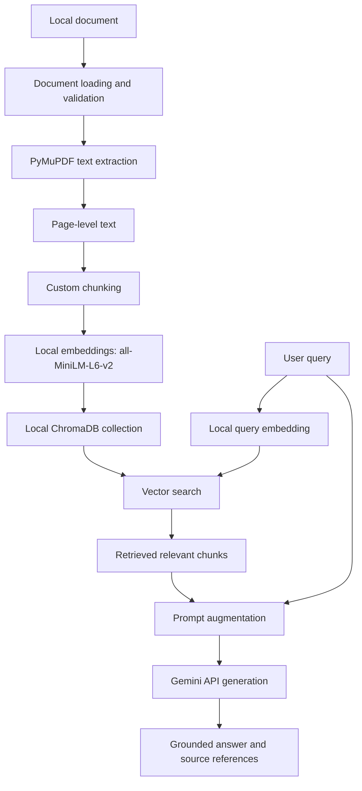

# Architecture

## Status and scope

This document describes the current ingestion, retrieval, prompt, and provider
architecture. The repository has verified document loading, page-level text
extraction, token-based chunking, batched local embeddings, persistent
ChromaDB storage, validated user queries, query embeddings, native vector
similarity search, context construction, prompt construction, and isolated
Gemini generation. End-to-end pipeline orchestration and a user-facing CLI
remain planned.

The file structure below is an initial boundary for learning and testing. It
may evolve as the project grows. If a feature requires a new module, folder, or
configuration file, that change should be proposed and explained before
implementation, and this document, the README, and the implementation plan
should be updated when their documented content changes.

## System overview

The initial RAG data flow has two phases:

```text
Phase 1: Document loading -> text extraction -> chunking
       -> local embedding generation -> vector storage

Phase 2: User query -> query embedding -> vector search -> retrieval
       -> prompt augmentation -> Gemini generation
       -> grounded answer with source references
```



## Current and planned structure

```text
app/
├── __init__.py
├── document_loader.py
├── document_identity.py
├── pdf_extractor.py
├── model_config.py
├── query.py
├── chunker.py
├── embeddings.py
├── vector_store.py
├── retriever.py
├── prompt_builder.py
└── llm_client.py

scripts/
├── manual_load_pdf.py     # developer-only ingestion check
├── manual_query_embedding.py
├── manual_vector_search.py
├── manual_retrieval.py
├── manual_context_builder.py
├── manual_prompt_builder.py
└── manual_llm_client.py

tests/
├── test_document_loader.py
├── test_pdf_extractor.py
├── test_chunker.py
├── test_embeddings.py
├── test_vector_store.py
├── test_query.py
├── test_retriever.py
├── test_prompt_builder.py
├── test_context_builder.py
└── test_llm_client.py

data/
└── chroma/                 # generated local persistence; not committed

prompts/
└── system_prompt.md        # trusted grounding instructions

# Planned application boundaries
app/
├── pipeline.py             # ingestion and question-answering orchestration
└── cli.py                  # interactive user interface
```

This structure is intentionally small. Additional structure should be added
only when a concrete feature makes the boundary useful.

The `scripts/` directory is separate from `tests/` and contains manually run
developer checks. `manual_load_pdf.py` exercises the implemented ingestion and
storage flow, including storing and retrieving chunks by ID. It is not part of
the automated pytest suite. Run it from the repository root as
`python -m scripts.manual_load_pdf`.

## Component responsibilities and boundaries

### Configuration and provider settings

There is not yet a shared `config.py`. `llm_client.py` loads `.env` with
`python-dotenv` and validates `LLM_API_KEY` and `LLM_MODEL` at the provider
boundary. Callers may also inject the key, model, and SDK client for tests.
Missing configuration and provider failures are surfaced as `LLMClientError`
without exposing credentials. A shared configuration boundary can be
introduced when pipeline orchestration needs settings beyond the provider.

### Document loading

`document_loader.py` validates and opens one local PDF with PyMuPDF. It checks
that the path exists, points to a regular `.pdf` file, and can be opened. It
rejects corrupted and password-protected PDFs with clear application errors.

This module returns an open PyMuPDF document to its caller. The caller owns
that document and must close it. It does not extract text, chunk content, or
perform any downstream processing.

**Input:** local PDF path  
**Output:** open, readable PyMuPDF document

Keeping loading separate from extraction makes file validation and resource
ownership independently testable.

### Text extraction

`pdf_extractor.py` extracts text page by page from the open PyMuPDF document
provided by the loading boundary. It returns immutable page-text records with
one-based page numbers, retains empty pages, and raises a clear
page-specific error if extraction fails.

**Input:** loaded PyMuPDF document
**Output:** ordered `PageText` records with page numbers and text

The caller owns and closes the document; this module does not open files or
close the document. Keeping loading separate from extraction makes resource
ownership and page-level extraction independently testable.

### Chunking

`chunker.py` uses a deterministic custom Python implementation to divide
page text into retrieval-friendly chunks. Chunk size and overlap are
configurable. Page and source metadata travel with every chunk.
`TextChunk` validates its document ID, page numbers, chunk index, token count,
and non-empty text at construction. Short and heading-only chunks remain valid
and retain page metadata; no arbitrary minimum is imposed.

**Input:** page-level text records  
**Output:** ordered chunks with source/page metadata

Custom chunking keeps the first implementation understandable and testable.
It may later need improvement for headings, tables, and complex layouts, but
those concerns are intentionally outside the initial scope.

### Local embeddings

`embeddings.py` loads `all-MiniLM-L6-v2` through
`sentence-transformers`. It generates vectors for document chunks
and user queries using the same model and compatible preprocessing.
Shared model, chunking, and dimension constants are kept in
`model_config.py`. Embedding generation rejects non-finite values in addition
to invalid shapes.

Document embeddings are generated locally. Answer generation is separate and
uses Gemini. The PDF is not uploaded to Gemini for embedding or generation as
a whole.

**Input:** text strings  
**Output:** vectors with a consistent dimension

Local embeddings reduce hosted API usage and keep PDF-derived processing on
the user's machine. The trade-offs are model download time, local memory
requirements, and local CPU/GPU performance.

### Vector storage

`vector_store.py` creates or opens a local persistent ChromaDB collection at
`data/chroma/` by default. It stores existing `EmbeddedChunk` embeddings
without regenerating them, along with deterministic chunk IDs, text, and
document/page/chunk/token metadata. Page numbers are serialized into a
ChromaDB-compatible string and converted back to a list during retrieval.
Storage validates 384-dimensional embeddings and required metadata, rejects
duplicate IDs within a batch, and permits updates only when an existing ID
still identifies the same document and chunk.

`document_identity.py` derives `document_id` from the resolved PDF path and
computes a separate SHA-256 content fingerprint. Re-indexing with the same
document ID and fingerprint skips storage. A changed fingerprint replaces all
records for that document and removes stale chunk IDs. Different resolved paths
remain separate documents even when their filenames match.
The store exposes a current-fingerprint check so unchanged documents can skip
chunking, embedding, and storage work before those stages run.

**Input:** embedded chunk records
**Output:** persisted records or records retrieved by ID

ChromaDB keeps the initial project local and avoids remote infrastructure. It
is not being treated as a multi-user production database at this stage.

The store's `similarity_search()` method validates a one-dimensional finite
384-value query vector and a positive integer `top_k`, then delegates ranking
to the existing L2-configured ChromaDB HNSW collection. It requests chunk
documents, metadata, and distances without fetching all embeddings into
Python. Results contain chunk IDs, text, document/page metadata, token counts,
and ChromaDB distance values. Empty collections return no results.

### User query

`query.py` validates and trims a natural-language query without restricting
question type. It returns an immutable `UserQuery` containing the normalized
text and enforces a configurable 2,000-character default maximum. It does not
classify intent, embed the query, access ChromaDB, or call an LLM.

**Input:** raw user-provided string
**Output:** validated `UserQuery`

### Query embedding

`embed_query()` in `embeddings.py` accepts a validated `UserQuery` and uses
the same lazily loaded `all-MiniLM-L6-v2` model, tokenizer, and centralized
configuration as document embedding. It checks the model's actual maximum
sequence length without truncation, then returns one finite 384-dimensional
vector. It does not classify queries, search ChromaDB, or generate answers.

**Input:** validated `UserQuery`
**Output:** one finite query embedding

### Vector similarity search

`VectorStore.similarity_search()` accepts an embedding from `embed_query()`
and uses native ChromaDB HNSW search against the persistent L2 collection. It
does not regenerate embeddings, migrate the collection, or calculate
distances in Python.

**Input:** one finite 384-dimensional query embedding and positive `top_k`
**Output:** ranked chunk records with text, source metadata, and distances

### Retrieval

`retriever.py` composes the validated `UserQuery`, local query embedding, and
native vector search components. `Retriever.retrieve()` returns immutable
ranked `RetrievedChunk` records and a `RetrievalResult` containing the original
query and separate embedding/search timings. It validates returned result
fields and duplicate chunk IDs while preserving document and page metadata.
It does not perform reranking, filtering, semantic deduplication, or call
Gemini.

**Input:** user query and retrieval settings  
**Output:** ranked chunks, scores where available, and source metadata

Initial top-k retrieval is simple and interpretable. It may later be extended
with hybrid search or reranking if evaluation shows that similarity search is
insufficient.

### Context building

`context_builder.py` converts a `RetrievalResult` into an immutable
`ContextResult` for future prompt construction. It preserves retrieval order,
source labels, ranks, document IDs, page numbers, and chunk IDs. It enforces a
configurable context-token budget using an injectable, model-agnostic token
counter. Chunks are included whole or excluded without truncation; excluded
chunks are reported, and distinct chunks are not removed based on similar
text.

The context builder does not embed queries, search ChromaDB, call Gemini, or
construct system prompts. `prompt_builder.py` consumes its structured result
to combine the context with system instructions and the user question.

### Prompt construction

`prompt_builder.py` loads trusted system instructions from
`prompts/system_prompt.md` and keeps them separate from the user message.
The user message contains the prepared context and original question in
explicit delimiters. Retrieved text is treated as untrusted reference data;
the instructions require context-grounded answers, clear insufficient-context
responses, and relevant source page citations.

This module does not call Gemini, so prompt formatting can be tested without a
network connection.

### Gemini provider integration

`llm_client.py` isolates all usage of the official `google-genai` Python SDK.
It reads `LLM_API_KEY` and `LLM_MODEL` from environment configuration, sends
the prompt's system instructions and user message separately, and returns a
validated generated response. It does not construct prompts or perform
retrieval. The SDK client can be injected so provider behavior remains
unit-testable without network calls.

Only the user query and retrieved context needed for generation should be sent
to Gemini. The complete PDF should not be uploaded to the API in the initial
implementation. This limits unnecessary data transfer and keeps the
retrieval pipeline provider-independent.

Provider errors, missing credentials, invalid credentials, quota errors, and
network failures must be surfaced clearly without logging secrets. No other
RAG component should import the Google SDK directly. Replacing Gemini later
should therefore require changing this adapter and related configuration,
rather than rewriting extraction or retrieval.

### Pipeline orchestration (planned)

`pipeline.py` will coordinate ingestion and question answering while keeping
component logic in its own module. Ingestion and query-time flows should
remain conceptually separate even if the initial CLI coordinates both.

### Command-line interface (planned)

`cli.py` will parse the local PDF input, provide the interactive question
loop, show useful progress and errors, and print answers with available source
references. One-shot question mode is planned for a later milestone.

## Data flow in detail

### Ingestion

1. The user supplies one local PDF.
2. The document loader validates and opens the PDF.
3. PyMuPDF extracts text page by page.
4. The custom chunker creates ordered, overlapping chunks.
5. `all-MiniLM-L6-v2` generates local vectors.
6. ChromaDB stores chunk text, existing vectors, IDs, and source/page metadata.

### Query and generation

1. A future CLI or caller supplies a question.
2. Query validation returns a `UserQuery`.
3. The local embedding model embeds the question.
4. ChromaDB performs vector similarity search.
5. The retriever validates and ranks the returned candidate chunks.
6. The prompt builder augments the question with retrieved context and
   source labels.
7. Gemini generates an answer from the augmented prompt.
8. A future CLI displays the answer and source/page references.

## Important design decisions

- **No LangChain or LangGraph initially:** direct Python modules make the
  pipeline easier to inspect and test.
- **Local embedding generation:** `all-MiniLM-L6-v2` handles both document and
  query embeddings locally.
- **Gemini for generation only:** the API is used for answer generation, not
  for indexing the complete PDF.
- **Configurable model:** `LLM_MODEL` avoids scattering a provider model name
  through application code. avoids scattering a model name through
  application code.
- **Local ChromaDB:** `data/chroma/` is used for persistence and should be
  excluded from Git.
- **Page-aware metadata:** page information is retained so answers can cite
  source locations.
- **Interactive-first CLI:** the question loop is the first interface;
  one-shot mode is deliberately deferred.
- **Mocked provider tests:** unit tests should mock Gemini responses to avoid
  quota usage and network dependence.
- **Evolving structure:** new files are justified by concrete requirements and
  documented before implementation rather than added speculatively.

## Decisions requiring verification or later approval

The following are not claimed as finalized implementation details:

1. The supported Python version after dependency compatibility is checked.
2. The exact Gemini model available to the user's API key.
3. The Gemini model's generation compatibility and applicable quota/rate
   limits.
4. Initial chunk size and overlap.
5. Default retrieval `top_k`.
6. Exact empty or weak-context behavior.
7. Whether ingestion and querying eventually become separate CLI commands.
8. The structure needed for future one-shot mode.

The Gemini model must be verified with the user's own credentials using the
official SDK before a default model is selected. Until then,
`.env.example` uses a placeholder model value.
