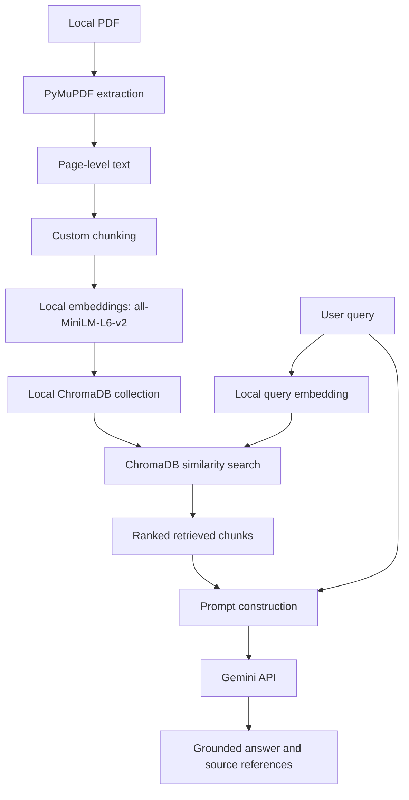

# Architecture

## Status and scope

This document describes the proposed initial architecture. The repository
currently contains documentation and configuration only; no application
components have been implemented or verified yet.

The file structure below is an initial boundary for learning and testing. It
may evolve as the project grows. If a feature requires a new module, folder, or
configuration file, that change should be proposed and explained before
implementation, and this document, the README, and the implementation plan
should be updated when their documented content changes.

## System overview

The initial RAG data flow is:

```text
PDF -> text extraction -> chunking -> local embedding generation
    -> vector storage -> query embedding -> similarity search
    -> context construction -> Gemini generation
    -> grounded answer with source references
```



## Proposed initial structure

```text
app/
├── __init__.py
├── cli.py
├── config.py
├── pdf_extractor.py
├── chunker.py
├── embeddings.py
├── vector_store.py
├── retriever.py
├── prompt_builder.py
├── gemini_client.py
└── pipeline.py

tests/
├── test_config.py
├── test_pdf_extractor.py
├── test_chunker.py
├── test_embeddings.py
├── test_vector_store.py
├── test_retriever.py
├── test_prompt_builder.py
├── test_gemini_client.py
└── test_pipeline.py

data/
└── chroma/                 # generated local persistence; not committed
```

This structure is intentionally small. The interactive CLI question loop is
implemented before the planned one-shot mode. Additional structure should be
added only when a concrete feature makes the boundary useful.

## Component responsibilities and boundaries

### Configuration

`config.py` will load `.env` using `python-dotenv`, read
`GEMINI_API_KEY` and `GEMINI_MODEL`, and validate required settings. Missing or
invalid configuration must produce a helpful error without exposing the API
key. Other components should receive validated configuration rather than
reading secrets independently.

### PDF extraction

`pdf_extractor.py` will open a local PDF with PyMuPDF and produce page-level
text records. Each record will retain page number and source-document
metadata. It will report missing, unreadable, and invalid PDFs explicitly.

**Input:** local PDF path  
**Output:** ordered page-level text records with metadata

### Chunking

`chunker.py` will use a deterministic custom Python implementation to divide
page text into retrieval-friendly chunks. Chunk size and overlap will be
configurable. Page and source metadata must travel with every chunk.

**Input:** page-level text records  
**Output:** ordered chunks with source/page metadata

Custom chunking keeps the first implementation understandable and testable.
It may later need improvement for headings, tables, and complex layouts, but
those concerns are intentionally outside the initial scope.

### Local embeddings

`embeddings.py` will load `all-MiniLM-L6-v2` through
`sentence-transformers`. It will generate vectors for both document chunks
and user queries using the same model and compatible preprocessing.

Document embeddings are generated locally. Answer generation is separate and
uses Gemini. The PDF is not uploaded to Gemini for embedding or generation as
a whole.

**Input:** text strings  
**Output:** vectors with a consistent dimension

Local embeddings reduce hosted API usage and keep PDF-derived processing on
the user's machine. The trade-offs are model download time, local memory
requirements, and local CPU/GPU performance.

### Vector storage

`vector_store.py` will create or open a local persistent ChromaDB collection.
It will store chunk IDs, text, embeddings, and source/page metadata, and expose
a small interface for insertion and similarity queries.

**Input:** chunk records and vectors, or a query vector  
**Output:** persisted records, or ranked matching records

ChromaDB keeps the initial project local and avoids remote infrastructure. It
is not being treated as a multi-user production database at this stage.

### Retrieval

`retriever.py` will embed a user query locally, query ChromaDB, and return the
top-k ranked chunks with metadata. It will not call Gemini.

**Input:** user query and retrieval settings  
**Output:** ranked chunks, scores where available, and source metadata

Initial top-k retrieval is simple and interpretable. It may later be extended
with hybrid search or reranking if evaluation shows that similarity search is
insufficient.

### Prompt construction

`prompt_builder.py` will format retrieved chunks with source/page labels,
include the user question, and provide grounding instructions. The prompt
will tell the model to answer from the supplied context and acknowledge when
the context does not support an answer.

This module will not call Gemini, so prompt formatting can be tested without a
network connection.

### Gemini provider integration

`gemini_client.py` will contain all usage of the official `google-genai`
Python SDK. It will create the client from validated configuration, use the
configured model, submit the question and retrieved context, and return the
generated answer.

Only the user query and retrieved context needed for generation should be sent
to Gemini. The complete PDF should not be uploaded to the API in the initial
implementation. This limits unnecessary data transfer and keeps the
retrieval pipeline provider-independent.

Provider errors, missing credentials, invalid credentials, quota errors, and
network failures must be surfaced clearly without logging secrets. No other
RAG component should import the Google SDK directly. Replacing Gemini later
should therefore require changing this adapter and related configuration,
rather than rewriting extraction or retrieval.

### Pipeline orchestration

`pipeline.py` will coordinate ingestion and question answering while keeping
component logic in its own module. Ingestion and query-time flows should
remain conceptually separate even if the initial CLI coordinates both.

### Command-line interface

`cli.py` will parse the local PDF input, provide the interactive question
loop, show useful progress and errors, and print answers with available source
references. One-shot question mode is planned for a later milestone.

## Data flow in detail

### Ingestion

1. The user supplies one local PDF.
2. PyMuPDF extracts text page by page.
3. The custom chunker creates ordered, overlapping chunks.
4. `all-MiniLM-L6-v2` generates local vectors.
5. ChromaDB stores chunk text, vectors, IDs, and source/page metadata.

### Query and generation

1. The user enters a question in the interactive CLI loop.
2. The local embedding model embeds the question.
3. ChromaDB performs similarity search.
4. The retriever returns the top-k chunks.
5. The prompt builder constructs grounded context with source labels.
6. Gemini receives the question and retrieved context.
7. The CLI displays the answer and source/page references.

## Important design decisions

- **No LangChain or LangGraph initially:** direct Python modules make the
  pipeline easier to inspect and test.
- **Local embedding generation:** `all-MiniLM-L6-v2` handles both document and
  query embeddings locally.
- **Gemini for generation only:** the API is used for answer generation, not
  for indexing the complete PDF.
- **Configurable model:** `GEMINI_MODEL` avoids scattering a model name through
  application code.
- **Local ChromaDB:** `data/chroma/` is proposed for persistence and should be
  excluded from Git.
- **Page-aware metadata:** page information is retained so answers can cite
  source locations.
- **Interactive-first CLI:** the question loop is the first interface;
  one-shot mode is deliberately deferred.
- **Mocked provider tests:** unit tests should mock Gemini responses to avoid
  quota usage and network dependence.
- **Evolving structure:** new files are justified by concrete requirements and
  documented before implementation rather than added speculatively.

## Decisions requiring verification or later approval

The following are not claimed as finalized implementation details:

1. The supported Python version after dependency compatibility is checked.
2. The exact Gemini model available to the user's API key.
3. The Gemini model's generation compatibility and applicable quota/rate
   limits.
4. Initial chunk size and overlap.
5. Default retrieval `top_k`.
6. Exact empty or weak-context behavior.
7. Whether ingestion and querying eventually become separate CLI commands.
8. The structure needed for future one-shot mode.

The Gemini model must be verified with the user's own credentials using the
official SDK before a default model is selected. Until then,
`.env.example` uses a placeholder model value.
